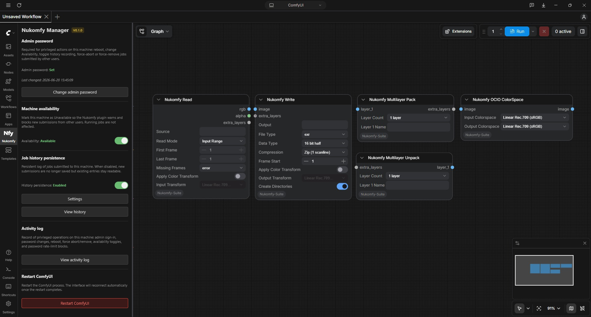
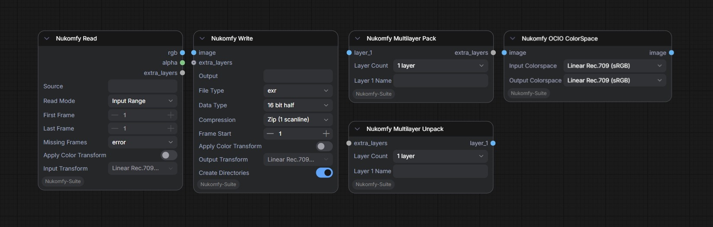

<h1 align="center">ComfyUI-Nukomfy-Suite</h1>

<p align="center">
  
</p>

<p align="center">Server-side companion custom nodes for the <a href="https://github.com/francescolorussi/Nukomfy">Nukomfy</a> Nuke plugin.</p>

<p align="center"></p>

## What it provides

- **Nodes** for Nuke-style input and output inside ComfyUI workflows: `NukomfyRead`, `NukomfyWrite`, `NukomfyOCIOColorSpace`, `NukomfyMultiLayerPack`, and `NukomfyMultiLayerUnpack`. They read frames into a workflow, write the results back to disk, and handle colorspace conversion.
- **Admin password gate** for privileged operations from Nukomfy clients (reboot, and force-abort or force-remove of another user's job).
- **Reboot endpoint** that restarts ComfyUI with no external dependency.
- **Availability toggle** to flag a ComfyUI host as not accepting new submissions without taking it offline.
- **Persistent job history** so the Render Manager can show past jobs, with their logs and output paths, for every user on the host, surviving ComfyUI restarts.
- **Activity log** that records every privileged operation, rolled over automatically as it grows and pruned by age.

This node pack is **required** on every ComfyUI host: the nodes that move frames between Nuke and ComfyUI are part of it, so Nukomfy cannot render without it. The admin, availability, history, and activity features are configured from a Nukomfy tab in the ComfyUI sidebar.

## Install

### ComfyUI Manager (recommended)

Open the **Manager**, search for **Nukomfy Suite**, and install it. ComfyUI Manager installs the node pack together with its Python dependencies for you. Restart ComfyUI when it finishes.

### Manual (git clone)

Clone the repo into your `custom_nodes` folder:

```
cd ComfyUI/custom_nodes
git clone https://github.com/francescolorussi/ComfyUI-Nukomfy-Suite
```

Then install the two Python dependencies listed in `requirements.txt`:

- `OpenImageIO >= 3.1.10`
- `fileseq`

ComfyUI portable:

```
python_embeded\python.exe -m pip install -r ComfyUI\custom_nodes\ComfyUI-Nukomfy-Suite\requirements.txt
```

Manual or venv install, from the Suite folder:

```
cd ComfyUI/custom_nodes/ComfyUI-Nukomfy-Suite
pip install -r requirements.txt
```

Restart ComfyUI.

For further information, see [How to Install Custom Nodes in ComfyUI](https://docs.comfy.org/installation/install_custom_node).

## Usage

After restarting, confirm the Suite loaded: the ComfyUI boot log prints `[Nukomfy Suite] INFO: loaded (0.1.0)`, and a **Nukomfy** tab appears in the ComfyUI sidebar. Open the tab to set or change the admin password, toggle availability, and read the activity log. The set-password form is the first-run entry point; the password-gated views unlock once a password exists.

For a workflow to work with Nukomfy, its input must go through a **Nukomfy Read** node and its output through a **Nukomfy Write** node. That is how the plugin knows where to feed frames in and where to collect the results.

## File layout

All persistent state lives under the ComfyUI user directory, so it survives node-pack upgrades. The folder is created on first write:

```
ComfyUI/
├── user/
│   └── default/
│       └── nukomfy_manager/
│           ├── auth.json               # admin password hash (scrypt) + salt
│           ├── availability.json       # current availability flag
│           ├── activity.jsonl          # activity log, append-only
│           ├── activity.jsonl.1        # rotated activity-log backup
│           ├── activity.jsonl.2        # older backup (up to 5 kept)
│           ├── activity_config.json    # activity-log retention setting
│           ├── job_history.db          # job-history store, SQLite (per host, all users)
│           └── job_history_config.json # job-history retention settings
└── custom_nodes/
    └── ComfyUI-Nukomfy-Suite/          # this repo
```

The activity log rotates by size (10 MB per file, up to 5 backups) and is purged by age at every ComfyUI boot. Default retention is 90 days, configurable from the sidebar.

## Nodes

<p align="center"></p>

Five nodes ship with the Suite:

| Display name | Class type | Category |
|---|---|---|
| Nukomfy Read | `NukomfyRead` | Nukomfy/Image |
| Nukomfy Write | `NukomfyWrite` | Nukomfy/Image |
| Nukomfy OCIO ColorSpace | `NukomfyOCIOColorSpace` | Nukomfy/Color |
| Nukomfy Multilayer Pack | `NukomfyMultiLayerPack` | Nukomfy/Channels |
| Nukomfy Multilayer Unpack | `NukomfyMultiLayerUnpack` | Nukomfy/Channels |

They read and write frames with OpenImageIO and handle color with OCIO. The Suite requires OpenImageIO 3.1.10 or newer: it is the first release that ships the ACES 2.0 Studio Config (`studio-config-v4.0.0`, built on OCIO 2.5), which the Suite uses as its default color config. Every colorspace menu lists what that config exposes.

- **File formats.** Nukomfy Read decodes any format the active OpenImageIO build supports (EXR, JPEG, PNG, TIFF, DPX, HDR, and more). Nukomfy Write emits EXR, JPEG, PNG, TIFF, DPX, HDR, and TGA. Multilayer features apply to EXR only.
- **Color.** Nukomfy Read, Nukomfy Write, and Nukomfy OCIO ColorSpace expose the colorspace list from the active OCIO config. An **Apply Color Transform** toggle on Read and Write (off by default) decides whether the selected transform runs or the pixels pass through unchanged.
- **Multilayer.** Nukomfy Multilayer Pack bundles extra layers (depth, normal, mask, motion, and so on) into a single value; connect it to the `extra_layers` socket of Nukomfy Write to produce a multilayer EXR that Nuke can read. Nukomfy Multilayer Unpack splits a bundle back into one image per layer.

## Endpoints

| Method | Path | Auth | Purpose |
|---|---|---|---|
| GET | `/nukomfy/manager/ping` | none | Discovery: version, password status, availability, history status, tamper flags, and node import status |
| GET | `/nukomfy/availability` | none | Current availability snapshot |
| GET | `/nukomfy/progress` | none | Live progress snapshot (`{prompt_id: {fraction, tooltip}}`) so a client can reseed bars it missed after a restart or as a second viewer |
| POST | `/nukomfy/admin/auth` | password | Verify the admin password |
| POST | `/nukomfy/admin/set_password` | password (first run: none) | Set or change the admin password |
| GET | `/nukomfy/admin/rate_limit_status` | none | Check whether the caller's IP is currently rate-limited |
| POST | `/nukomfy/admin/integrity/restore` | password | Run the integrity check and restore recoverable state files from cache |
| POST | `/nukomfy/admin/reboot` | password | Restart the ComfyUI process |
| POST | `/nukomfy/admin/force_abort` | password | Interrupt a running job regardless of owner |
| POST | `/nukomfy/admin/force_remove` | password | Drop a pending job from the queue regardless of owner |
| POST | `/nukomfy/abort` | none | Abort the running job (the path the normal Abort button uses); `409` when the job is not running |
| GET | `/nukomfy/history/{nfy_job_id}` | none | Look up a runtime-history entry by Nukomfy short id; returns the same payload as ComfyUI's native `/api/history/{prompt_id}` |
| POST | `/nukomfy/availability/set` | password | Set availability to `available` or `unavailable` |
| POST | `/nukomfy/activity/tail` | password | Return the last `n` activity entries (default 200, max 1000) |
| GET | `/nukomfy/activity/config` | none | Read the activity-log retention setting |
| POST | `/nukomfy/activity/config/set` | password | Update the activity-log retention and run a cleanup pass |
| GET | `/nukomfy/jobs/history` | none | Paginated persisted job history. Query: `limit` (default 100, max 1000), `offset`, `since`, `status`, `q` |
| GET | `/nukomfy/jobs/history/{prompt_id}` | none | One persisted history entry by `prompt_id`; `404` when unknown |
| GET | `/nukomfy/jobs/history/{prompt_id}/workflow_api` | none | The workflow (API) snapshot stored for that entry; `404` when none |
| POST | `/nukomfy/jobs/history/clear` | password | Drop every row from the job-history store |
| GET | `/nukomfy/jobs/history/config` | none | Read the job-history retention settings |
| POST | `/nukomfy/jobs/history/config/set` | password | Update job-history retention (`enabled`, `max_jobs_to_keep`, `max_days_to_keep`) |

## Security

The admin password is hashed with scrypt, a password-hashing algorithm built into the Python standard library, using a random salt. Only the resulting hash is saved, in `auth.json` under the ComfyUI user directory; the password itself is never stored and cannot be recovered from the hash. On systems with Unix-style permissions the file is readable only by its owner.

Login is rate-limited per IP address: ten wrong attempts within a minute block that address for a minute, and no other client is affected.

## Troubleshooting

| Symptom | Cause | Recovery |
|---|---|---|
| Forgot admin password | `auth.json` stores a scrypt hash with a random salt, so the original password cannot be recovered. | Delete `ComfyUI/user/default/nukomfy_manager/auth.json` on the host. The Manager reverts to "no password set" and the sidebar offers the set-password form again. No restart needed; reloading the sidebar picks up the missing file. |
| Admin endpoint returns `429 Too Many Requests` | 10 failed password attempts from one IP within 60 seconds block that IP for 60 seconds. Other IPs are unaffected. | Wait 60 seconds. Restarting ComfyUI also clears the in-memory rate-limit state. |
| Plugin says "Manager not installed on this machine" | The node pack failed to load, or `/nukomfy/manager/ping` does not respond. | (a) Verify `ComfyUI/custom_nodes/ComfyUI-Nukomfy-Suite/` exists on the target machine; (b) check the ComfyUI boot log for `[Nukomfy Suite] INFO: loaded (0.1.0)`; (c) test directly with `curl http://<host>:<port>/nukomfy/manager/ping`. |
| Reboot button is disabled or replies "Manager not installed" | Same root cause as above. The reboot endpoint is part of this node pack, not ComfyUI core. | Install the Suite on the target machine, or accept that it cannot be rebooted from Nukomfy. |
| `force_abort` or `force_remove` returned `200 OK` but the job is still listed | The `prompt_id` was not running or queued when the request reached the server (it likely finished a moment earlier). The response carries `action_performed: false`. | Expected behavior: a silent no-op, mirroring `/api/interrupt`. Refresh the Render Manager; the job has already finished. |
| Sidebar shows a red "Graph nodes unavailable" banner and the Nukomfy nodes are missing from the node menu | The node dependencies (`OpenImageIO` or `fileseq`) are not installed in the ComfyUI Python environment, so the nodes could not import. The rest of the Manager (sidebar, reboot, availability, activity log) keeps working. | Install the dependencies and restart ComfyUI (see [Install](#install)). The banner names the missing module. |

## License

ComfyUI-Nukomfy-Suite is licensed under the Apache License 2.0. See the [LICENSE](LICENSE) file for the full text.
